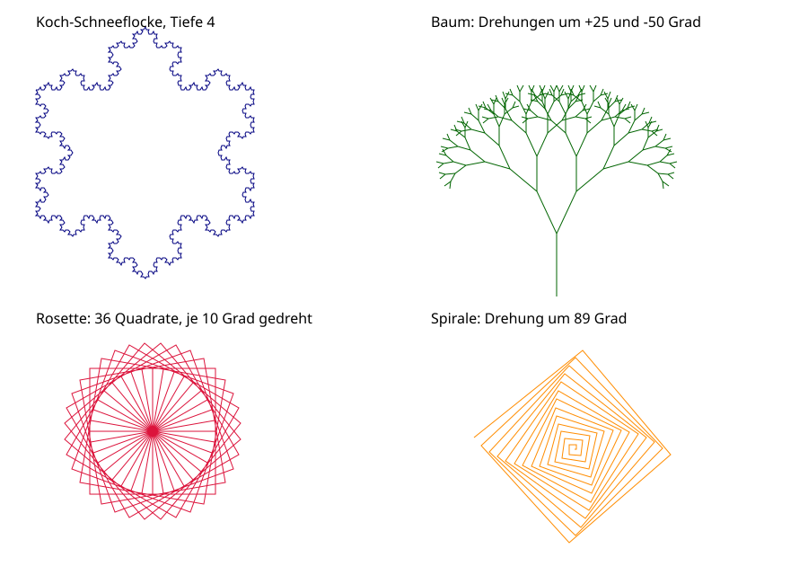

# MiniForth-Anwendungen: ein Rundgang durch neun Beispiele

Dieses Paket zeigt, was sich mit der 64K-Fassung von MiniForth bauen lässt: eine Liste, ein Ausdrucksbaum mit Ableitung, Bruchrechnung, Trigonometrie, Turtle-Grafik als SVG und Nim, portiert aus der Übungsaufgabe `nim.java`. Alle Beispiele sind im neuen Stil geschrieben, also **ohne Stack-Shuffler** und **mit benannten lokalen Variablen**. Sie laufen mit der mitgelieferten, **unveränderten** `MiniForth.java` und sind getestet.

| Nr. | Datei | Thema | Was man dabei sieht |
|---:|---|---|---|
| 01 | `01-liste.mf` | Cons-Liste | Null-Objekt, Funktionsobjekte, Persistenz |
| 02 | `02-ausdrucksbaum.mf` | Ausdrucksbaum | Kompositum, Schablonenmethode, symbolisches Ableiten |
| 03 | `03-division.mf` | `/` und `mod` | Division aus Addition und Vergleich gebaut |
| 04 | `04-brueche.mf` | Bruchrechnung | unveränderliche Objekte, Euklid, Überlauf |
| 05 | `05-trigonometrie.mf` | Sinus, Kosinus | zwei Näherungen als Strategien |
| 06 | `06-turtle.mf` | Turtle-Grafik | SVG-Ausgabe ohne Überlauf des String-Pools |
| 07 | `07-nim-xor.mf` | Nim mit XOR | Satz von Bouton |
| 08 | `08-nim-negamax.mf` | Nim mit Negamax | Portierung von `nim.java`, Suchbaum als Cache |
| 09 | `09-nim-vergleich.mf` | beide Nim-Strategien | alle 2871 Bretter, ein entarteter Suchbaum |

---

## 0 Vorbereitung

### Was im Paket liegt

```text
MiniForth.java            die Maschine, unverändert aus dem 64K-Paket
MiniForth-Anwendungen.md  dieses Dokument
README.md                 Kurzanleitung
beispiele/                neun lauffähige Programme mit ihren Sollausgaben (*.out.txt, *.out.svg)
bibliothek/               wiederverwendbare Bausteine: arith, trig, turtle, map, nim, nim-xor, nim-negamax
tests/                    Testprogramme und der Vergleich mit nim.java
run_tests.py              prüft alles (braucht nur Python 3 und Java)
einbinden.py              überträgt Bibliotheksänderungen in die Beispiele
TEST-RESULTS.txt          Protokoll des letzten Testlaufs
```

### Übersetzen und ausführen

```sh
javac -encoding UTF-8 MiniForth.java
java MiniForth beispiele/01-liste.mf
```

Jedes Beispiel wird so gestartet, nur mit einem anderen Dateinamen. Die Turtle schreibt SVG, das leitet man in eine Datei um:

```sh
java MiniForth beispiele/06-turtle.mf > turtle.svg
```

Die Option `-encoding UTF-8` braucht man unter Windows, weil `MiniForth.java` Umlaute in Fehlermeldungen enthält.

### Prüfen

```sh
python3 run_tests.py
```

Der Lauf übersetzt `MiniForth.java` und prüft 19 Punkte. Dazu gehören:

- ob die eingebundenen Bibliotheken aktuell sind,
- alle neun Beispiele Zeichen für Zeichen gegen ihre Sollausgabe,
- das interaktive Nim,
- sechs unabhängige Gegenrechnungen in Python (Division, Trigonometrie, Brüche, Ausdrucksbaum, SVG, Nim-Zählungen),
- zweimal Nim gegen das Original `nim.java`, falls `jshell` vorhanden ist (ab JDK 9).

Das Protokoll steht in `TEST-RESULTS.txt`: 19 von 19 bestanden.

### Drei Dinge, die die Maschine nicht hat, und wie die Beispiele damit umgehen

**1. Kein `/` und kein `mod`.** MiniForth kennt nur `+`, `-`, `*`, `<` und `=`. Die Bibliothek `arith.mf` definiert `/` und `mod` deshalb selbst, als ganz normale Wörter (Beispiel 03). Danach schreibt man `a b /`, als gäbe es die Division schon immer.

**2. Nur eine Quelldatei.** `java MiniForth` liest genau eine Datei. Damit jedes Beispiel für sich läuft, steht der Text der benutzten Bibliotheken wörtlich im Beispiel, eingerahmt von Markierungen:

```text
# >>> bibliothek/arith.mf
...Text der Bibliothek...
# <<< bibliothek/arith.mf
```

Wer eine Bibliothek ändert, ruft danach `python3 einbinden.py` auf, und alle Beispiele werden aktualisiert. Der Testlauf meldet, wenn das vergessen wurde. Der eigene Teil eines Beispiels steht immer hinter dem letzten Block.

**3. Ein String-Pool mit 1023 Einträgen.** Jedes Stringliteral, jedes `str` und jedes `concat` legt einen Eintrag an. Gleiche Strings werden wiederverwendet, aber nichts wird je freigegeben. Für normale Ausgaben reicht das gut. Wer aber tausende verschiedene Zeilen erzeugt, bekommt „String-Pool voll“. Das ist beim Testen tatsächlich passiert: Die erste Fassung des Nim-Vergleichs mit 2870 Ausgabezeilen brach nach 95 Zeilen ab. Der Ausweg: Zahlen mit `.` ausgeben, jede auf einer eigenen Zeile. `.` legt keinen Pool-Eintrag an. Die Turtle nutzt genau das (Beispiel 06).

### Spielregeln für diszipliniertes Programmieren

MiniForth prüft keine Typen. Die Beispiele halten sich an diese Regeln:

1. **Der Empfänger liegt oben.** Aus Javas `liste.map(f)` wird `f liste send map`.
2. **Zwischenergebnisse bekommen Namen.** Statt Werte auf dem Stack umzuordnen, legt man sie mit `local x` und `to x` ab. Das macht den Code lesbar wie Java.
3. **Hauptprogramme sind Wörter.** `local` gibt es nur in Definitionen. Jedes Beispiel endet deshalb mit `: demo ( -- ) ... ; demo`.
4. **Klassen vor ihrer Benutzung definieren.** `new Cons` wird beim Übersetzen aufgelöst.
5. **Gegenseitige Rekursion über `send`.** Zwei globale Wörter können sich nicht gegenseitig aufrufen, zwei Methoden über `this send` schon.
6. **In Stringliteralen keine Raute** (sie beginnt einen Kommentar) **und keine doppelten Anführungszeichen.** Mehrere Leerzeichen werden zu einem. Für SVG nimmt man einfache Anführungszeichen.

Die Grenzen sind gegenüber früher großzügig: je Klasse 16 virtuelle Methoden, 16 Felder, 16 lokale Slots je Methode und 64K Speicherzellen. Deshalb hat jetzt fast jede Klasse ein `toString`.

---

## 1 Die Liste nach dem Cons-Modell (`01-liste.mf`)

**Aufruf:** `java MiniForth beispiele/01-liste.mf`

**Was das Programm macht.** Es baut die Liste 1 bis 10 und wendet nacheinander `size`, `sum`, `map`, `filter` und `reverse` an. Danach sortiert es eine zweite Liste durch Einfügen.

**Wie es funktioniert.** Eine Liste ist entweder leer (`Nil`) oder ein Kopf mit einer Restliste (`Cons`). Beide Klassen verstehen dieselben Nachrichten. `Nil` antwortet mit dem Ergebnis für die leere Liste, `Cons` erledigt sein Element und reicht die Nachricht an `tail` weiter. Nirgends steht „ist die Liste leer?“: Die Fallunterscheidung erledigt die dynamische Bindung. Das ist das **Null-Objekt-Muster**.

```text
class Cons
    field head
    field tail
    : size ( -- n )        tail send size  1 + ;
    : sum ( -- n )         tail send sum  head + ;
    : map ( f -- l )       head f send apply  f tail send map  new Cons send init ;
    ...
end
class Nil
    : size ( -- n )        0 ;
    : sum ( -- n )         0 ;
    : map ( f -- l )       new Nil ;
    ...
end
```

**Funktionsobjekte.** `map` und `filter` bekommen ein Objekt mit einer Methode `apply`. So sind Javas Lambdas gemeint: Ein funktionales Interface hat genau eine abstrakte Methode. `AddN` merkt sich in einem Feld, was addiert werden soll; das ist eine Closure, gebaut als Objekt. Jedes Funktionsobjekt beschreibt sich über `toString` selbst, die Ausgabe zeigt deshalb, welches „Lambda“ gerade wirkt.

**Das Hauptprogramm** benutzt drei lokale Variablen statt Stack-Akrobatik:

```text
: demo ( -- )
    local numbers
    local f
    local mixed
    1 11 range to numbers
    numbers .o
    new Square to f
    f .o
    f numbers send map .o
    ...
;
demo
```

**Was passiert** (Ausschnitt):

```text
[1, 2, 3, 4, 5, 6, 7, 8, 9, 10]
10
55
x -> x * x
[1, 4, 9, 16, 25, 36, 49, 64, 81, 100]
x -> x ist gerade
[2, 4, 6, 8, 10]
...
x -> x + 100
[101, 102, 103, 104, 105, 106, 107, 108, 109, 110]
[10, 9, 8, 7, 6, 5, 4, 3, 2, 1]
[1, 2, 3, 4, 5, 6, 7, 8, 9, 10]
Summe der Quadrate aller geraden Zahlen von 1 bis 10:
220
Sortieren durch Einfuegen:
[3, 1, 4, 1, 5, 9, 2, 6]
[1, 1, 2, 3, 4, 5, 6, 9]
```

Nach `reverse` wird die Ausgangsliste noch einmal ausgegeben, und sie ist unverändert. Die Liste ist **persistent** wie Javas `List.of(...)`. Die 220 kommt aus einer Pipeline, die sich wie ein Java-Stream liest: `new Square  new IsEven numbers send filter  send map  send sum`.

**Darauf hinweisen.**

- `Cons` steht vor `Nil`, weil `Nil.insert` die Klasse `Cons` beim Namen braucht. `Cons` braucht `Nil` nie beim Namen.
- `IsEven` kommt ohne `mod` aus: Es zieht so lange 2 ab, bis 0 oder 1 übrig bleibt. So bleibt das Beispiel frei von Bibliotheken.

**Übungen:** `contains ( x -- f )`; `fold ( f start -- r )` mit einem zweistelligen Funktionsobjekt; `append ( other -- l )`.

---

## 2 Ein Ausdrucksbaum (`02-ausdrucksbaum.mf`)

**Aufruf:** `java MiniForth beispiele/02-ausdrucksbaum.mf`

**Was das Programm macht.** Es baut f(x) = 3x² + 2x + 1 als Baum, gibt den Baum aus, erstellt eine Wertetabelle, leitet zweimal ab, vereinfacht und faltet zum Schluss Konstanten in einem zweiten Ausdruck.

**Wie es funktioniert.** Jeder Knoten ist ein Objekt einer der Klassen `Num`, `Var`, `Add`, `Sub` oder `Mul`, und jeder versteht `eval`, `toString`, `derive` und `simplify`. Das ist das **Kompositum-Muster** und zugleich ein Interpreter, der in MiniForth läuft, das wiederum in Java läuft.

**Der Clou: Der Quelltext ist schon Postfix.** Mit den Konstruktorwörtern `num`, `x`, `plus` und `times` schreibt man den Ausdruck in umgekehrter polnischer Notation hin, und der Stack baut den Baum:

```text
3 num  x x times  times   2 num x times   plus   1 num   plus  to f
```

**Schablonenmethode.** `Bin` ist die Oberklasse der zweistelligen Knoten. Ihr `toString` ist für alle gleich und holt sich das Operatorzeichen mit `this send op`. Das liefert erst die Unterklasse:

```text
class Bin extends Expr
    : toString ( -- s )
        "(" l send toString concat " " concat  this send op concat
        " " concat  r send toString concat  ")" concat
    ;
end
class Add extends Bin
    : op ( -- s )         "+" ;
    : eval ( x -- v )     x l send eval  x r send eval  + ;
    : derive ( -- e )     l send derive  r send derive  new Add send init ;
    ...
```

**Vereinfachen.** `simplify` vereinfacht erst beide Kinder und reicht sie dann an die Klassenmethode `Add.smart`, `Sub.smart` oder `Mul.smart` weiter. Die falten Konstanten (aus `2 + 3` wird `5`) und streichen neutrale Elemente (`e + 0`, `e * 1`, `0 * e`).

**Was passiert:**

```text
(((3 * (x * x)) + (2 * x)) + 1)
Wertetabelle:
f(0) = 1
f(1) = 6
f(2) = 17
f(3) = 34
f(4) = 57
Ableitung, roh und vereinfacht:
((((0 * (x * x)) + (3 * ((1 * x) + (x * 1)))) + ((0 * x) + (2 * 1))) + 0)
((3 * (x + x)) + 2)
f'(2) =
14
Zweite Ableitung:
6
Konstanten falten:
((((2 + 3) * x) + 0) * 1)
(5 * x)
```

Die rohe Ableitung ist die Produktregel, mechanisch angewandt. Vereinfacht steht da 3 · 2x + 2, und f'(2) = 14 stimmt.

**Übungen:** eine Klasse `Neg`; ein Knoten `Pow` für Potenzen; die Kettenregel für eine Klasse `Square`.

---

## 3 Division und Rest selbst gebaut (`03-division.mf`)

**Aufruf:** `java MiniForth beispiele/03-division.mf`

**Was das Programm macht.** Es teilt einige Zahlenpaare, auch negative, und zeigt Quotient und Rest. Danach macht es die Probe q · b + r = a und versucht, durch 0 zu teilen.

**Wie es funktioniert.** `udiv` ist schriftliche Division im Zweiersystem, nur rekursiv aufgeschrieben. Um a durch b zu teilen, teilt man a erst durch 2b. Das Ergebnis q verdoppelt man und prüft dann, ob in den Rest noch einmal b hineinpasst:

```text
: udiv ( a b -- q )
    local q
    local r
    a b < if 0 else
    a b - b < if 1 else                  # b <= a < 2b
        a  b b +  udiv to q              # q = a / 2b
        a  q b b + *  -  to r            # r = a - q * 2b, also 0 <= r < 2b
        q q +  r b < if 0 else 1 then  +
    then then
;
```

Die Rekursion ist höchstens 31 Ebenen tief, eine je Bit. Der Vergleich `a b - b <` statt `a b b + <` verhindert, dass `b + b` überläuft. `/` kümmert sich um die Vorzeichen, `mod` ist `a - (a / b) * b`. Beides verhält sich genau wie in Java: Der Quotient wird zur Null hin abgeschnitten, der Rest hat das Vorzeichen des Dividenden.

**Was passiert:**

```text
17 / 5 = 3 Rest 2
-17 / 5 = -3 Rest -2
17 / -5 = -3 Rest 2
-17 / -5 = 3 Rest -2
0 / 7 = 0 Rest 0
2147483647 / 7 = 306783378 Rest 1
Probe: q * b + r ergibt wieder a
-2147483647
Teilen durch 0:
Division durch 0
0
```

Teilen durch 0 meldet sich mit einer Zeile und liefert 0. Eine Ausnahme kann MiniForth nicht werfen.

**Darauf hinweisen.** So arbeiten Prozessoren ohne Divisionsbefehl, etwa frühe 8-Bit-Rechner. Und es zeigt, wie erweiterbar die Sprache ist: `/` ist ein Wort wie jedes andere.

---

## 4 Bruchrechnung (`04-brueche.mf`)

**Aufruf:** `java MiniForth beispiele/04-brueche.mf`

**Was das Programm macht.** Es rechnet mit Brüchen: die Grundrechenarten, die harmonische Zahl H(10), die Eulersche Zahl e als Reihe und die Wurzel aus 2 nach dem Newton-Verfahren. Ergebnisse gibt es als Bruch und als Dezimalzahl.

**Wie es funktioniert.** Ein `Frac` ist unveränderlich. Die Klassenmethode `Frac.make` kürzt jeden neuen Bruch mit dem größten gemeinsamen Teiler und schiebt das Vorzeichen in den Zähler. Euklid ist eine Zeile:

```text
: gcd ( a b -- g )    b 0 = if a else b  a b mod  gcd then ;
```

Beim Addieren multipliziert `addParts` nicht einfach die Nenner, sondern bildet ihr kleinstes gemeinsames Vielfaches. Sonst liefe schon die Reihe für e über:

```text
:: addParts ( a b c e -- f )       # a/b + c/e ueber das kgV der Nenner
    local g
    b e gcd to g
    a e g / *  c b g / *  +   b g / e *  Frac.make
;
```

`decimal` dividiert schriftlich, Ziffer für Ziffer, und baut daraus einen String.

**Was passiert:**

```text
Grundrechenarten:
3/4
-1/2
5/6
-1/4
1/2
2
1
Harmonische Zahl H(10) = 1 + 1/2 + ... + 1/10:
7381/2520
2.928968
Eulersche Zahl e als Summe 1/0! + 1/1! + ... + 1/12!:
260412269/95800320
2.718281828
Wurzel aus 2 nach Newton: x -> (x + 2/x) / 2
1
3/2
17/12
577/408
665857/470832
1.41421356237
```

e stimmt auf neun Stellen, die Wurzel aus 2 nach vier Newton-Schritten auf elf. Der Test rechnet jede Zeile mit Pythons `fractions.Fraction` nach.

**Die ehrliche Grenze.** Ein fünfter Newton-Schritt müsste 665857² ≈ 4,4 · 10¹¹ rechnen. Das passt nicht in 32 Bit, und das Ergebnis wäre still falsch. Bei e ist mit 12! Schluss. Ein guter Anlass für `Math.multiplyExact` und `BigInteger` in Java.

**Übungen:** Kettenbrüche; das Maximum einer Bruchliste aus Beispiel 01 mit `less`.

---

## 5 Sinus und Kosinus mit ganzen Zahlen (`05-trigonometrie.mf`)

**Aufruf:** `java MiniForth beispiele/05-trigonometrie.mf`

**Was das Programm macht.** Es gibt eine Tabelle von −360 bis +360 Grad in Schritten von 45 Grad aus, mit zwei Näherungen für Sinus und Kosinus.

**Wie es funktioniert.** Winkel sind ganze Grad mit beliebigem Vorzeichen. `norm` bringt sie auf 0 bis 359. Ergebnisse werden mit 10000 multipliziert, `45 sin` liefert also 7071 für 0,7071. Die Klassen `Bhaskara` und `Taylor` erben von `Trig`. Beide implementieren `sin`. `cos` steht nur einmal in der Oberklasse, als cos x = sin(x + 90).

- **Bhaskara I. (7. Jahrhundert, Indien):** sin x ≈ 4x(180 − x) / (40500 − x(180 − x)) für 0 bis 180 Grad. Eine einzige Bruchrechnung ohne Bogenmaß, bei 0, 30, 90, 150 und 180 Grad sogar exakt.
- **Taylor-Polynom bis x⁷** im Horner-Schema, x(1 − x²/6 · (1 − x²/20 · (1 − x²/42))). Mit lokalen Variablen liest es sich Schritt für Schritt:

```text
: taylor7 ( d -- s )
    local x
    local x2
    local t
    d 31416 * 180 / to x              # Bogenmass mal 10000
    x x * 10000 / to x2
    10000  x2 42 /  -  to t
    10000  x2 t * 10000 / 20 /  -  to t
    10000  x2 t * 10000 / 6 /  -  to t
    x t * 10000 /
;
```

**Was passiert** (Anfang der Tabelle):

```text
Winkel | sin Bhaskara | sin Taylor | cos Bhaskara | cos Taylor (mal 10000)
-360 | 0 | 0 | 10000 | 9999
-315 | 7058 | 7071 | 7058 | 7071
-270 | 10000 | 9999 | 0 | 0
...
```

**Genauigkeit.** Der Test vergleicht alle ganzen Winkel von −360 bis 360 mit Pythons `math.sin` und `math.cos`. Der größte Fehler liegt bei Bhaskara bei 0,0016 und bei Taylor bei 0,0002.

---

## 6 Turtle-Grafik als SVG (`06-turtle.mf`)

**Aufruf:** `java MiniForth beispiele/06-turtle.mf > turtle.svg`, danach `turtle.svg` im Browser öffnen. Die Sollausgabe `beispiele/06-turtle.out.svg` ist dasselbe Bild.

**Was das Programm macht.** Es zeichnet vier Figuren in eine SVG-Datei: eine Koch-Schneeflocke, einen Baum, eine Rosette und eine Spirale. Zusammen sind das 1474 Linien.



**Wie es funktioniert.** Eine `Turtle` hat Position, Blickrichtung, einen Stift und eine Trigonometrie-Strategie aus Beispiel 05. `forward` läuft geradeaus, `turn` dreht um einen Winkel, positiv heißt links herum, auch um −360 bis +360 Grad. Positionen werden mit 10000 multipliziert gespeichert und erst bei der Ausgabe gerundet. So summieren sich die Rundungsfehler über tausend Schritte nicht auf.

**Der Ausgabetrick.** Jede Koordinate als String zusammenzubauen würde den String-Pool sprengen: 1474 Linien, aber nur 1023 Einträge. Deshalb gibt die Turtle jede Zahl mit `.` aus, auf einer eigenen Zeile. In einem SVG-Pfad ist ein Zeilenumbruch einfach Leerraum:

```text
<path fill='none' stroke='navy' d='
M
40
100
L
43
100
...
'/>
```

```text
: forward ( len -- )
    x  len heading trig send cos *  +  to x
    y  len heading trig send sin *  -  to y     # SVG: y waechst nach unten
    pen if "L" else "M" then .s  this send point
;
```

**Der Baum** zeigt die Rekursion am schönsten: ein Stück vorwärts, 25 Grad links, kleiner Baum, 50 Grad rechts, kleiner Baum, 25 Grad zurück, rückwärts zum Astansatz.

```text
: tree ( t len k -- )
    0 k < if
        len t send forward
         25 t send turn   t len 3 * 4 /  k 1 -  tree
        -50 t send turn   t len 3 * 4 /  k 1 -  tree
         25 t send turn
        0 len - t send forward                # zurueck zum Astansatz
    then
;
```

Baum und Spirale sind mit `Taylor` gezeichnet, Schneeflocke und Rosette mit `Bhaskara`. Mit bloßem Auge sieht man keinen Unterschied.

**Übungen:** eine Hilbert-Kurve oder ein Sierpinski-Dreieck; die Strichstärke als weiteres Feld der Turtle.

---

## 7 bis 9 Nim nach `nim.java`

Die drei Nim-Beispiele portieren die Übungsaufgabe `nim.java`. Regeln, Grenzen, Reihenfolge der Züge und alle Ausgabetexte sind übernommen: Ein Zug nimmt mindestens einen Stick aus genau einer Reihe, wer den letzten nimmt, gewinnt. Die Reihen werden ab 0 gezählt. Erlaubt sind höchstens 16 Sticks, höchstens 7 je Reihe und höchstens 4 nichtleere Reihen.

### Die Bausteine

| Bibliothek | Inhalt | entspricht in `nim.java` |
|---|---|---|
| `map.mf` | binärer Suchbaum `Node`/`Leaf`, `get` liefert 0 für fehlende Schlüssel | `new int[1 << 12]` |
| `nim.mf` | Brett, `init`, `isValid`, `show`, `move`, `undo`, `gameOver`, `play`, `help` | gleichnamige Methoden |
| `nim-xor.mf` | `xor`, `nimsum`, Klasse `Xor` | (neu) |
| `nim-negamax.mf` | `key`, Klasse `Negamax` mit `value`, `scan`, `bestMove`, `wins` | `key`, `negamax`, `bestMove` |

`play` und `help` fragen `Nim.engine send bestMove` und `Nim.engine send wins`. Welche Strategie antwortet, entscheidet allein das Objekt in `Nim.engine`.

### Von Java nach MiniForth

**Ein Brett ohne `int[]`.** Das Brett ist eine verkettete Liste von Reihen (`Row`, am Ende `End`) mit Indexzugriff: `at` liest `board[i]`, `change` verändert eine Reihe. Man schreibt die Reihen in natürlicher Reihenfolge hin und hängt sie von hinten an. Der Vergleich mit den Java-Aufrufen:

```text
2 3 4 5 leer row row row row init to Nim.board     # int[] board = init(2, 3, 4, 5);
board show                                         # System.out.println(show(board));
board 0 2 move show                                # System.out.println(show(move(board, 0, 2)));
board play                                         # play(board);
board help                                         # help(board);
```

**Der Schlüssel durch Zählen statt Sortieren.** Java kopiert das Brett, sortiert es durch Einfügen und hängt die nichtleeren Reihen mit je 3 Bit aneinander. MiniForth zählt stattdessen für v = 1 bis 7, wie viele Reihen genau v Sticks haben, und hängt v so oft an. Das ist Sortieren durch Zählen und ergibt dieselben Schlüssel. Für 2 3 4 5 ist das oktal 2345, also 1253.

**Ein Suchbaum als Cache, und nur einer.** Wo Java ein `int[4096]` anlegt, steht hier die Map aus `map.mf`. Java legt bei jedem `bestMove` einen frischen Cache an und überlässt den alten dem Garbage Collector. MiniForth hat keinen Garbage Collector, jeder alte Cache bliebe als Müll im Speicher liegen. Da sich die Bewertung einer Stellung nie ändert, behält die MiniForth-Fassung einen Cache für immer. Die Ergebnisse sind dieselben.

**Die Schleife wird Rekursion.** Javas `negamax` durchläuft die Züge in einer Schleife: Reihen aufsteigend, Sticks absteigend. `scan` geht rekursiv in genau dieser Reihenfolge vor und findet deshalb denselben ersten Gewinnzug. `value` und `scan` rufen sich gegenseitig über `this send` auf. Die lokale Variable `v` hält die Bewertung über das Zurücknehmen des Zugs hinweg:

```text
: scan ( b i k -- m )    # erster Zug ab Reihe i mit k Sticks, nach dem der Gegner verliert
    local v
    i b send length < if
        k 0 = if  b  i 1 +  b i 1 + sticks  this send scan
        else
            b i 0 k - change                  # move
            b this send value to v            # negamax
            b i k change                      # undo
            v -1 = if i 8 * k + else b i  k 1 -  this send scan then
        then
    else 0 then
;
```

Ein Zug ist eine einzige Zahl, 8 · Reihe + Anzahl. 0 heißt „kein Gewinnzug“.

**Zufall.** Javas `help` schlägt in einer Verlustposition einen zufälligen Zug vor. MiniForth benutzt den Zufallsgenerator des ZX81, x ← (75x + 74) mod 65537. Er ist reproduzierbar, deshalb lassen sich die Ausgaben testen.

### Beispiel 07: die XOR-Strategie

**Aufruf:** `java MiniForth beispiele/07-nim-xor.mf`

Nach dem Satz von Bouton (1901) ist eine Stellung genau dann verloren für den, der am Zug ist, wenn das XOR aller Reihen 0 ist. XOR wird aus `/` und `mod` gebaut, Bit für Bit:

```text
: xor ( a b -- r )
    a b + 0 = if 0 else
        a 2 mod  b 2 mod  +  2 mod      # letztes Bit
        a 2 /  b 2 /  xor  2 *  +       # restliche Bits
    then
;
```

Der Gewinnzug steht in der ersten Reihe, die sich auf `Reihe xor s` verkleinern lässt.

**Was passiert.** Das Programm spielt die Partie aus dem Java-Demo nach. Das Startbrett 2 3 4 5 hat das XOR 0, wer beginnt, steht also schon auf Verlust:

```text
XOR-Strategie
0: I I
1: I I I
2: I I I I
3: I I I I I
XOR aller Reihen:
0
Dies ist eine Verlustposition. Bei perfektem Gegenspiel gibt es keinen Gewinnzug.
Vorschlag: Entferne 5 Sticks aus Reihe 3.
0:
1: I I I
2: I I I I
3: I I I I I
Computer entfernt 2 Sticks aus Reihe 1.
...
Ungueltiger Zug
...
Computer entfernt 1 Stick aus Reihe 2.
0:
1:
2:
3:
Computer gewinnt!
Das Spiel ist bereits beendet.
```

Der Mensch nimmt 2 Sticks aus Reihe 0, der Computer antwortet. Ein verbotener Zug (9 Sticks aus Reihe 2) wird abgelehnt, und das Brett bleibt unverändert. Am Ende gewinnt der Computer, und ein weiteres `play` meldet, dass das Spiel vorbei ist.

### Beispiel 08: Negamax mit Suchbaum

**Aufruf:** `java MiniForth beispiele/08-nim-negamax.mf`

Dieselbe Partie mit `Negamax`. Bis auf die erste Zeile und den Schlüssel statt des XOR ist die Ausgabe Zeile für Zeile gleich. In jeder Reihe gibt es höchstens einen Gewinnzug, deshalb wählen beide Strategien immer denselben.

**Selbst spielen.** MiniForth liest die Tastatur, wenn keine Datei angegeben ist. Man schickt also erst das Beispiel und dann die Tastatur hinein:

```sh
cat beispiele/08-nim-negamax.mf - | java MiniForth
```

Nach der Vorführung wartet die Maschine auf Eingaben:

```text
3 4 5 leer row row row neu      # neues Brett anlegen und zeigen
board help                      # Tipp holen
board 0 1 move show             # 1 Stick aus Reihe 0 nehmen
board play                      # Computer zieht
```

Das funktioniert unter Linux und macOS, unter Windows in der Git Bash oder in WSL.

### Beispiel 09: beide Strategien auf allen Brettern

**Aufruf:** `java MiniForth beispiele/09-nim-vergleich.mf` (dauert etwa eine Sekunde)

Das Programm durchläuft alle 8⁴ Belegungen von vier Reihen, prüft jede auf Gültigkeit und befragt beide Strategien:

```text
Negamax mit Suchbaum-Cache
XOR-Strategie
Gueltige Bretter mit vier Reihen:
2871
Davon gleiches Urteil (Gewinn oder Verlust):
2871
Davon nicht leer und mit gleichem Zug:
2870
Verschiedene Stellungen im Cache und Tiefe des Suchbaums:
222
222
```

- **Ein Satz, nachgeprüft durch Rechnen.** Negamax kennt kein XOR und kommt doch auf jedem Brett zum selben Urteil und zum selben Zug.
- **Der Suchbaum ist zur Liste entartet.** 222 Stellungen bei einer Tiefe von 222: Die Schlüssel kommen in aufsteigender Reihenfolge an, und jeder neue Knoten hängt rechts am letzten. Genau deshalb balanciert Javas `TreeMap` als Rot-Schwarz-Baum. Und deshalb nimmt `nim.java` ein Array: Der Schlüssel ist eine kleine Zahl und taugt direkt als Index.

### Gegen das Original geprüft

`run_tests.py` lädt `tests/nim-java/nim.java` in JShell und vergleicht für alle 2870 nichtleeren gültigen Bretter den besten Zug, die Bewertung und den Cache-Schlüssel. Das Ergebnis ist mit beiden Strategien identisch. Die MiniForth-Seite gibt dabei jede Zahl auf einer eigenen Zeile aus, sonst liefe der String-Pool über.

**Übungen:** Misère-Nim, bei dem verliert, wer den letzten Stick nimmt, als dritte Strategie; Negamax ohne Cache und die Rechenzeit vergleichen.

---

## Vorschlag für die Vorführung

1. **Liste, 15 Minuten.** Null-Objekt und Funktionsobjekte als direkter Draht zu Javas Lambdas und Streams.
2. **Ausdrucksbaum, 15 Minuten.** Mit dem Postfix-Aufbau beginnen, dann ableiten.
3. **Division, 5 Minuten.** Zeigen, dass `/` ein selbst definiertes Wort ist.
4. **Turtle, 10 Minuten.** Erst das Bild, dann den Baum im Quelltext und den Ausgabetrick.
5. **Nim, 15 Minuten.** `nim.java` neben die MiniForth-Fassung legen, live gegen Negamax spielen, den Satz von Bouton auflösen, Beispiel 09 zeigen.
6. **Brüche und Trigonometrie als Lesestoff,** mit den Übungen.

Der rote Faden durch alles: Polymorphie ersetzt Fallunterscheidungen, Objekte mit einer Methode ersetzen Funktionen, Namen ersetzen Stack-Akrobatik, und am Ende ist alles Zahlen in einem `int[]`.
