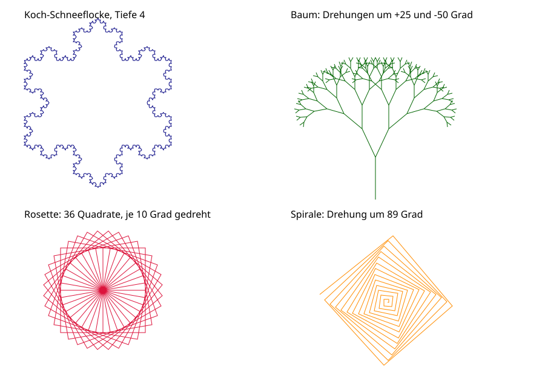

# MiniForth OO: Eine OO-Sprache in 300 Zeilen Java

Eine komplette objektorientierte Sprache mit Compiler und ByteCode-Maschine in 300 Zeilen Java? Nur mit Ganzzahlen, Strings, Arrays und Methoden und ohne Objekte? Das geht! Alles ist nur eine Sache der Organisation eines 64K großen Speichers; 64K sind 65536 Speicherzellen, die jeweils ein `int` aufnehmen können. Darin spielt sich alles ab.

Wenn Sie einen direkten Einstieg suchen, legen Sie hier los:

* Der Code [MiniForth.java](./MiniForth-Lehrpaket-64K/MiniForth.java)
* Ein Skript zum Verständnis des Codes: [MiniForth-Lehrskript-64K.html](https://raw.githack.com/denkspuren/MiniForthOO/main/MiniForth-Lehrpaket-64K/MiniForth-Lehrskript-64K.html) (zu finden im Lehrpaket)

## Mehr lernen mit weniger geht kaum

Die Umsetzung von MiniForth ist sehr kompakt und dicht, und dennoch baut die Sprache die Objektorientierung von Java nach. Die ByteCode-Maschine hat sogar Verwandschaft mit der JVM (Java Virtual Machine). 

Wenn Sie dieses Stückchen Code verstehen, lernen Sie eine stapelbasierte Virtuelle Maschine mit einem einfachen ByteCode kennen – das ist eine einfache Simulation eines kleinen Mikroprozessors. Sie kommen in Berührung mit systemnaher Programmierung. Und es ist ein bißchen Compilerbau dabei, da einfache Sprachkonstrukte in ByteCode übersetzt werden. Die Speicherorganisation enthält alles, was man für das Verständnis eines Callstacks (Aufrufstapel) mit den darauf abgelegten Frames braucht; Sie sehen genau, was ein Heap ist und wie darauf Objekte und Klassen abgelegt werden. Sie sind damit mitten im Maschinenraum der Objektorientierung.

Mehr über die Informatik und die Programmierung kann man kaum mit so wenig Code lernen 😎. Das steigert sich, wenn Sie sich die Anwendungsbeispiele anschauen. Man kann sogar das Rechnen mit Fließkommazahlen in MiniForth selber nachbauen, einschließlich der Berechnung von Sinus und Cosinus. Und kleine, ernsthafte OO-Programme sind damit auch möglich.

**Hinweis**: Ich habe viel Erfahrung mit stapelbasierten Programmen und konkatenativen Sprachen. Das ist die Basis für sehr kompakte Programmiersprachen. Ich habe ChatGPT gebeten, eine solche Sprache in 300 LOC (Lines Of Code) in einfachem Java zu schreiben, die das OO-Modell von Java realisiert. Das Experiment ist gelungen. Das gesamte Material ist von ChatGPT für uns generiert worden. Nun ist es an uns, das Resultat zu verstehen!

## Ein Überblick

Sie finden hier drei separate Verzeichnisse. Alles dreht sich um `MiniForth.java`; diese Datei finden Sie deshalb in jedem der Verzeichnisse, damit Sie innerhalb des Verzeichnisses mit MiniForth arbeiten können.

**Lehrpaket-64K**: Die Heimat von MiniForth.java mit zahlreichen Tests und einer Einführung in MiniForth. Die wichtigsten Dateien sind das Programm `MiniForth.java` und der Einführungstext `MiniForth-Lehrskript-64K.html`.

**Anwendungen**: Hier finden sich Beispielprogramme, die zeigen, was man mit MiniForth sinnvolles programmieren kann. Eine schöne Übung ist: Wie sieht die Entsprechung als Java-Programm aus? Schreiben Sie die Programme mal in Java.

Schauen Sie sich um. Sehr beeindruckend sind die Turtle-Grafiken.

Oder wollen Sie Nim spielen?

**Explorer**: Man kann MiniForth-Programme bei der Ausführung tracen (mitschreiben) und sich die Ausführung im Explorer anschauen und nachvollziehen. Der Explorer zeigt Ihnen das Innenleben bei der Ausführung eines Programms. Das soll Ihnen helfen, die Interna zu verstehen und nachzuvollziehen. Das Lehrskript aus dem Lernpaket und der Explorer sollten gut zueinander passen.

## Einsatz

MiniForth OO ist zu Lehrzwecken entstanden. Das Java-Programm nutzt kaum mehr als das, was man in den ersten 4 Wochen am Anfang des Informatik-Studiums bei der Programmierung lernt. Und es ist ein schönes Beispiel, wie einem 300 Zeilen Code dennoch einiges abverlangen können. Wer es tut, kann sehr viel dabei lernen.

Viel Spaß & viel Erfolg!